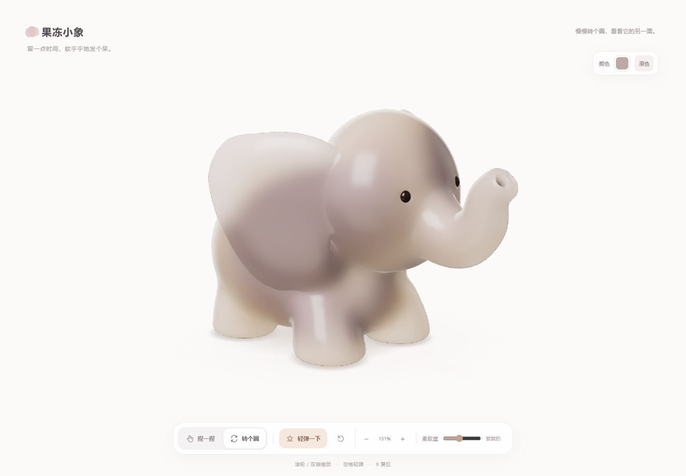
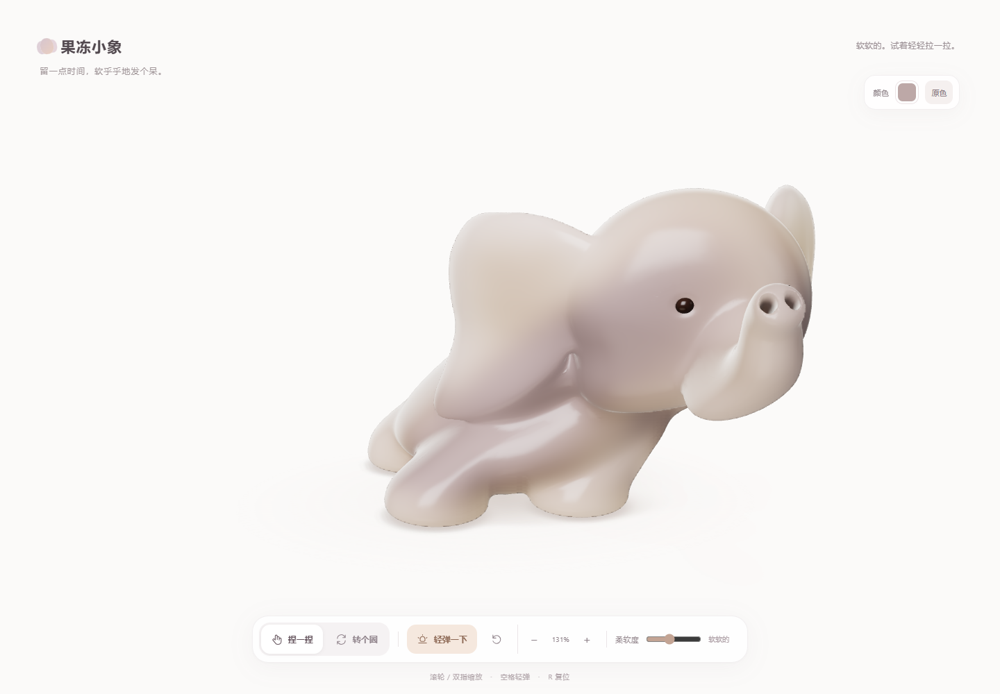

# 果冻小象｜独立本地网站

## 实际网页画面

在白色影棚里旋转小象，从不同角度观察造型和果冻质感。



按住上半身向外拖动，脚底保持在地面；松手后身体会弹回。



以上图片来自本地运行的网页截图。

双击 `打开果冻小象.cmd`，在浏览器中使用本机网站（`127.0.0.1:5194`）。运行需要本机安装 Node.js，不需要联网。HTML、JavaScript、样式与 GLB 位于 `jelly-site/`；请保留目录结构和 `scripts/` 启动脚本。

按住小象上半身拖动，脚底会留在地面，松手后弹回；工具栏可切换旋转、调整柔软度和缩放。右上角色盘可自定义颜色，“原色”恢复默认。

选择“转个圈”，左右拖动可环绕，上下拖动可连续改变俯仰角，一直看到近乎正俯视；方向键也可调整视角，按 `R` 或点击复位恢复初始角度。右上方“不透明度”滑杆可在 20% 到 100% 之间调节，默认 100%。调至 100% 时会减少内部透光散射，让外观更扎实，同时保留果冻高光。透明效果采用实时表面混合，展示效果不包含真实折射。

可编辑网页源码在 `src/jelly/`，网页入口为 `jelly-elephant.html`。身体互动使用简化的弹簧和四足支撑模型，不是完整体积软体模拟。

## Blender 模型

[下载可编辑的 Blender 源文件（约 26 MB）](assets/blender/jelly-elephant/jelly-elephant-v25-studio-clear.blend)。建议使用 Blender 5.2 或更新版本打开；文件包含小象模型、眼睛、材质、棚灯、相机及可编辑形态键，参考图片已打包。网页使用的 [GLB 模型](assets/blender/jelly-elephant/jelly-elephant-v25-smooth.glb)也可以单独下载。网页里的交互回弹由网页程序计算，并非 Blender 文件自带的完整软体模拟。

## 独立重新构建

重新构建需要 Node.js 22.12 或更新版本，并在首次安装依赖时联网；运行仓库中现成的网站不需要安装这些依赖或联网。在项目目录中执行：

```powershell
npm ci
npm run build
npm test
```

构建只读取小象入口与源码；脚本会将模型和构建资源放入 `jelly-site/`。浏览器自动检查需另行安装 Playwright 的 Chromium：`npx playwright install chromium`，启动网站后运行 `npm run test:browser`。目前极限拉伸在高倍率下可能出画，耳尖和尾巴可能变尖；材质尚未完成最终独立美术验收。

第三方组件及许可见 [THIRD_PARTY_NOTICES.md](THIRD_PARTY_NOTICES.md)。
